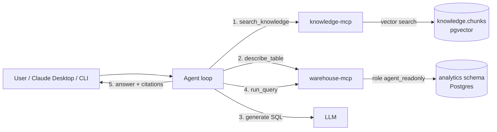

# Agentic Analytics

**Secure, cited text-to-SQL over MCP, grounded by RAG.** Ask a business question,
get read-only SQL, the result and the documents the answer relied on.

> Status: **v0.1**: foundation + basic RAG. See [RELEASE_PLAN.md](RELEASE_PLAN.md) for the roadmap.


_Regenerate with `vhs docs/demo.tape`._

## Problem

Text-to-SQL demos break on real warehouses for three reasons:

1. **Business definitions live outside the schema.** "Revenue" means
   `status IN ('shipped','completed','returned')`. No column name tells you that.
2. **Schemas are too big to paste into a prompt.** The model needs the few
   tables relevant to *this* question.
3. **Agents with database access are a security risk** unless the database
   itself enforces read-only access.

This project retrieves the relevant definitions and tables (RAG), generates SQL
against them, runs it through a read-only MCP server and answers with citations.
Every claim is measured on a versioned eval set.

## Architecture



Two MCP servers, split by **trust boundary**:

| Server | Touches | Postgres role | Tools |
|---|---|---|---|
| `warehouse-mcp` | Warehouse data (sensitive) | `agent_readonly` | `list_tables`, `describe_table`, `run_query` |
| `knowledge-mcp` | Docs index only | `knowledge_reader` | `search_knowledge`, `get_documents` |

Neither role can read the other's schema. Details: [docs/architecture.md](docs/architecture.md).

## Quickstart

Requires Docker, [uv](https://docs.astral.sh/uv/) and one LLM provider. Any
OpenAI-compatible provider works; set `LLM_PROVIDER` in `.env`:

| Provider | Key | Default model | Cost |
|---|---|---|---|
| `gemini` | `GEMINI_API_KEY` ([AI Studio](https://aistudio.google.com)) | `gemini-3.5-flash-lite` | Free tier (15 RPM, 500/day) |
| `ollama` | none | `qwen2.5-coder:7b` | Free, local |
| `openai` | `OPENAI_API_KEY` | `gpt-4.1-mini` | Paid |
| `azure` | `AZURE_OPENAI_API_KEY` + endpoint | your deployment | Paid |

```bash
make bootstrap                    # uv sync, .env, Postgres, seed ~900k rows, embed docs
# set LLM_PROVIDER and its key in .env (free-tier: also LLM_RPM, e.g. 14)
make ask Q="What was net revenue in 2024?"
make ask Q="What was net revenue in 2024?" CONFIG=baseline   # no RAG, for comparison
```

### Use the servers from Claude Desktop

Copy [config/claude_desktop_config.example.json](config/claude_desktop_config.example.json)
into Claude Desktop's config, set the absolute path, restart. Both servers work
with any MCP client; no agent code involved.

## MCP tool contracts

All tools are annotated `readOnlyHint: true` and return structured output (JSON schema).

| Tool | Input | Output |
|---|---|---|
| `warehouse.list_tables` | `schema` | `[{table, row_estimate}]` |
| `warehouse.describe_table` | `table` | `{table, columns: [{name, type, nullable}]}` |
| `warehouse.run_query` | `sql`, `max_rows` (≤1000) | `{columns, rows, row_count, truncated, sql_executed, elapsed_ms}` |
| `knowledge.search_knowledge` | `query`, `k`, `source_types` | `[{chunk_id, source_type, title, content, table_names, metadata, score}]` |
| `knowledge.get_documents` | `chunk_ids` | same as above, no score |

## RAG ingestion

- **Sources:** dbt-style table docs, governed metric definitions (YAML), known data
  issues, team glossaries ([data/docs](data/docs)).
- **Structure-aware chunking:** one chunk per table, metric, issue or glossary doc.
  Every retrieved chunk is a complete, citable unit (`metric:net_revenue`).
- **Metadata:** source type, path, referenced tables, owner, `updated_at`,
  `deprecated` / `outdated` flags.
- **Embeddings:** `BAAI/bge-small-en-v1.5` via fastembed (local ONNX, no key), stored
  in `pgvector` with an HNSW index.
- **Idempotent:** re-ingestion re-embeds only chunks whose content hash changed.
- **Schema linking:** the agent describes only tables referenced by retrieved chunks.

## Security model (v0.1)

Read-only is enforced by **Postgres**, not the prompt:

| Threat | Defense | Tested in |
|---|---|---|
| `INSERT` / `UPDATE` / `DELETE` / DDL | `default_transaction_read_only = on` | `tests/test_servers_db.py` |
| Write hidden in a CTE | Same; Postgres rejects it at execution | `tests/test_servers_db.py` |
| Escaping read-only mode | Role has only `SELECT` grants | manual check, see CHANGELOG |
| Reading the RAG index from the warehouse role | No grant on `knowledge` schema | `tests/test_servers_db.py` |
| Runaway queries | `statement_timeout = 10s`, auto `LIMIT` | `tests/test_sql.py` |
| Stacked statements | Single-statement check (sqlglot) | `tests/test_sql.py` |

Planned for v0.4: AST allowlist, per-user identity (OAuth 2.1 to Postgres RLS), PII
masking, prompt-injection filtering, audit log.

## Evaluation

- **Set:** 30 questions ([evals/questions/v0_1.yaml](evals/questions/v0_1.yaml)) with gold
  SQL: simple (10), joins (8), aggregation (8), filters (4).
- **Execution accuracy:** run gold and predicted SQL, compare result sets. Row order
  ignored, numbers rounded to 4 decimals, extra predicted columns allowed if a subset
  matches exactly ([evals/metrics/compare.py](evals/metrics/compare.py)).
- **Table recall@5:** share of tables the gold SQL needs that appear in the top 5
  retrieved chunks.
- **Configs:** `baseline` = full schema (names and types), no docs. `rag` = retrieved docs
  plus schema of retrieved tables only.

```bash
make check-gold          # all gold SQL runs (no LLM)
make eval-all            # baseline + rag, updates the table below
```

### Results

<!-- RESULTS:START -->
| Version | Config | Model | Questions | Exec accuracy | Table recall@5 | p50 (s) | p95 (s) | $ / success |
|---|---|---|---|---|---|---|---|---|
| v0.1 | baseline | gemini-3.5-flash-lite | 30 | 56.7% | — | 4.3 | 10.5 | — |
| v0.1 | rag | gemini-3.5-flash-lite | 30 | 100.0% | 1.00 | 4.4 | 8.1 | — |

Accuracy by category:

| Version | Config | aggregation | filters | joins | simple |
|---|---|---|---|---|---|
| v0.1 | baseline | 0.0% | 75.0% | 50.0% | 100.0% |
| v0.1 | rag | 100.0% | 100.0% | 100.0% | 100.0% |
<!-- RESULTS:END -->

## Data

Synthetic e-commerce warehouse, fixed seed, ~900k rows: regions, customers,
products, orders, order_items, payments, refunds, plus a deprecated
`legacy_orders_v1`. Planted traps for evals:

- Known issues: NULL `channel` before 2023-03 (ISSUE-001), NULL refund `reason`
  before 2024 (ISSUE-002), ~2% customers without region (ISSUE-003).
- A deprecated table and an outdated 2022 revenue guide.
- Two conflicting definitions of "active customer" (finance vs marketing).

## Known limitations (v0.1)

- Pure vector retrieval; no keyword search or reranking yet (v0.2).
- Fixed pipeline: no clarifying questions, no SQL self-correction (v0.3).
- One shared database role; no per-user permissions (v0.4).
- 30-question eval set is small; results are directional.
- Results come from one run per config. Gemini is not deterministic even at
  temperature 0: across earlier runs RAG scored between 90.0% and 96.7%. Repeated
  runs with mean and range arrive in v0.2.
- Cost per query is blank for models without a known list price (set `LLM_PRICE_IN`/`LLM_PRICE_OUT`).
- Data and docs are synthetic.

## Project layout

```text
servers/warehouse_mcp   read-only warehouse tools
servers/knowledge_mcp   RAG retrieval tools
agent/                  orchestration loop, prompts, LLM wrapper
ingestion/              chunking + embedding pipeline
data/seed, data/docs    synthetic data generator, knowledge sources
evals/                  questions, metrics, runner, versioned results
config/                 MCP server registry, feature flags
infra/                  docker compose, Postgres roles and tables
docs/adr                architecture decision records
```

Adding an MCP server = one entry in [config/servers.yaml](config/servers.yaml).
Adding an ablation = one entry in [config/features.yaml](config/features.yaml).

## Decisions

- [ADR-001: Two MCP servers split by trust boundary](docs/adr/001-two-mcp-servers.md)
- [ADR-002: Small explicit agent loop instead of a framework](docs/adr/002-custom-agent-loop.md)
