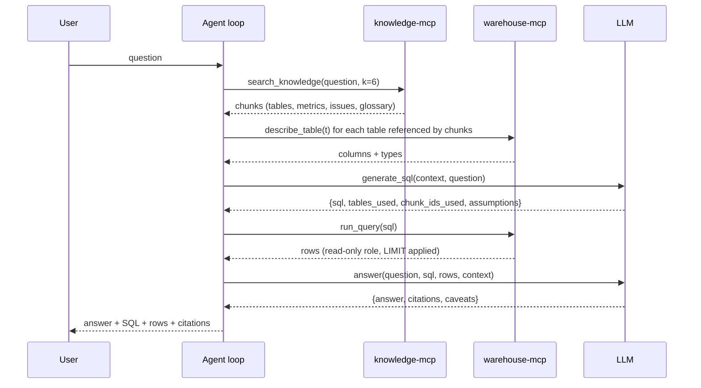

# Architecture (v0.1)

## Request flow

`baseline` config skips the search step and describes every table instead.

## Database layout

| Schema | Contents | Readable by |
|---|---|---|
| `analytics` | Warehouse tables | `agent_readonly` |
| `knowledge` | `chunks` table with `vector(384)` embeddings, HNSW index | `knowledge_reader` |

Both roles: `default_transaction_read_only = on`, statement timeout, no CREATE.
Seeding and ingestion use the `postgres` admin role.

## Defense layers for `run_query`

1. Single-statement check and `LIMIT` injection (`servers/warehouse_mcp/sql.py`)
2. Read-only transactions (role setting)
3. SELECT-only grants (role privileges)
4. 10s statement timeout (role setting)

Layers 2 to 4 hold even if layer 1 is bypassed. That is the point: the
database is the enforcement layer.
